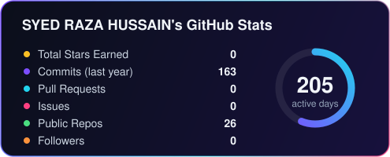
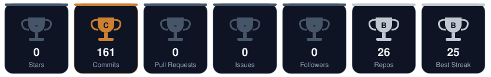
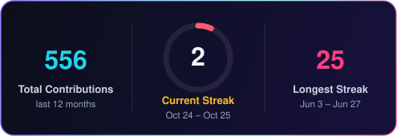
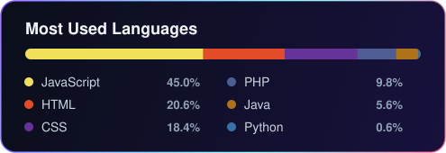
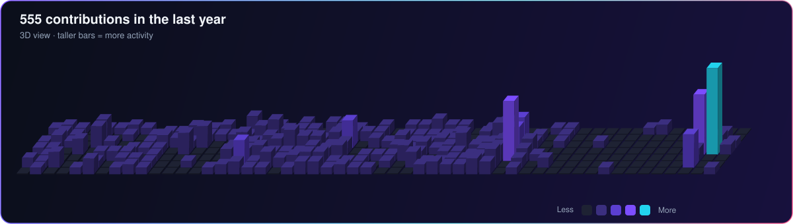
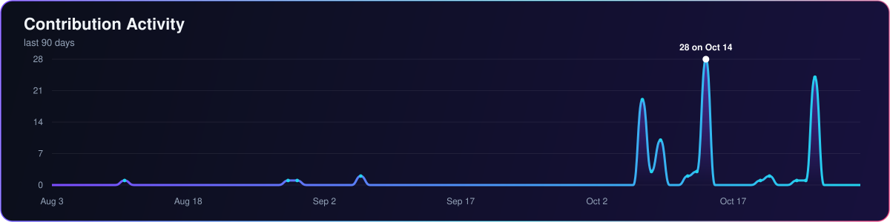

<h3>A Passionate Software Developer from India &nbsp;|&nbsp; Full-Stack Developer &nbsp;|&nbsp; MERN Stack Developer &nbsp;|&nbsp; Database Engineer</h3>

 

  

  

  

<!--  -->

<svg xmlns="http://www.w3.org/2000/svg" xmlns:c2pa="http://c2pa.org/manifest" width="1200" height="140" viewBox="0 0 1200 140" fill="none"><metadata><c2pa:manifest>AAAWgmp1bWIAAAAeanVtZGMycGEAEQAQgAAAqgA4m3EDYzJwYQAAABZcanVtYgAAAEdqdW1kYzJtYQARABCAAACqADibcQN1cm46YzJwYTo0ZjQ3MDFlZS1jNmU2LTQ0NDItYjI1Yy1kNjhlN2ExYTQ2MmQAAAADl2p1bWIAAAApanVtZGMyYXMAEQAQgAAAqgA4m3EDYzJwYS5hc3NlcnRpb25zAAAAALxqdW1iAAAARGp1bWRjYm9yABEAEIAAAKoAOJtxE2MycGEuaW5ncmVkaWVudC52MwAAAAAYYzJzaBuzKDGKK6T/q1gY9cgakXwAAABwY2JvcqNpZGM6Zm9ybWF0bWltYWdlL3N2Zyt4bWxqaW5zdGFuY2VJRHgseG1wOmlpZDpkMDU1YmJmNC1mMzFlLTQ4YTEtOTk1Yi04NTcwMDNmMzcxZWZscmVsYXRpb25zaGlwaHBhcmVudE9mAAAB4mp1bWIAAABBanVtZGNib3IAEQAQgAAAqgA4m3ETYzJwYS5hY3Rpb25zLnYyAAAAABhjMnNoqRSVeV6WWCD4S4e5rfXS1QAAAZljYm9yomdhY3Rpb25zgqJmYWN0aW9ua2MycGEub3BlbmVkanBhcmFtZXRlcnOha2luZ3JlZGllbnRzgaJjdXJseC1zZWxmI2p1bWJmPWMycGEuYXNzZXJ0aW9ucy9jMnBhLmluZ3JlZGllbnQudjNkaGFzaFgg2PcDopqKAxlvbBVQxHEY+Jir8gxZib2ZtoWmPHlu4uCkZmFjdGlvbngdY29tLmFudGhyb3BpYy5jbGF1ZGUucHJvdmlkZWRqcGFyYW1ldGVyc6F4H2NvbS5hbnRocm9waWMub3JpZ2luLWNvbmZpZGVuY2VndW5rbm93bmtkZXNjcmlwdGlvbnhmQ2xhdWRlIHByb3ZpZGVkIHRoaXMgZmlsZSBhdCB0aGUgcmVxdWVzdCBvZiBhIHVzZXIgYW5kIG1heSBoYXZlIGNyZWF0ZWQgb3IgbW9kaWZpZWQgdGhlIGZpbGUgY29udGVudHMubXNvZnR3YXJlQWdlbnShZG5hbWVmQ2xhdWRlcmFsbEFjdGlvbnNJbmNsdWRlZPUAAADIanVtYgAAAEBqdW1kY2JvcgARABCAAACqADibcRNjMnBhLmhhc2guZGF0YQAAAAAYYzJzaItlXMHyC7KA0SRtVS/wPb4AAACAY2JvcqVjYWxnZnNoYTI1NmNwYWRNAAAAAAAAAAAAAAAAAGRoYXNoWCBlbiTuPWwrF952+/sUxlXaqwjfFWwFSkSPoGA2JYV7pWRuYW1lbmp1bWJmIG1hbmlmZXN0amV4Y2x1c2lvbnOBomVzdGFydBikZmxlbmd0aBkeBAAAAj5qdW1iAAAAJ2p1bWRjMmNsABEAEIAAAKoAOJtxA2MycGEuY2xhaW0udjIAAAACD2Nib3KlY2FsZ2ZzaGEyNTZpc2lnbmF0dXJleE1zZWxmI2p1bWJmPS9jMnBhL3VybjpjMnBhOjRmNDcwMWVlLWM2ZTYtNDQ0Mi1iMjVjLWQ2OGU3YTFhNDYyZC9jMnBhLnNpZ25hdHVyZWppbnN0YW5jZUlEeCx4bXA6aWlkOjA4YzI0MmQ3LTk0MDItNGYwNy05OGE0LTVkYzMxYWRkODEwYnJjcmVhdGVkX2Fzc2VydGlvbnODomN1cmx4LXNlbGYjanVtYmY9YzJwYS5hc3NlcnRpb25zL2MycGEuaW5ncmVkaWVudC52M2RoYXNoWCDY9wOimooDGW9sFVDEcRj4mKvyDFmJvZm2haY8eW7i4KJjdXJseCpzZWxmI2p1bWJmPWMycGEuYXNzZXJ0aW9ucy9jMnBhLmFjdGlvbnMudjJkaGFzaFggAd2kTo8pbtMpDkJDBhUN4iQrtvcTfN2WlqfAUX3TACWiY3VybHgpc2VsZiNqdW1iZj1jMnBhLmFzc2VydGlvbnMvYzJwYS5oYXNoLmRhdGFkaGFzaFggp/p+/BIesOpzcRFcT+XnVKQeMCnAndMsvQ7dr/H/7i90Y2xhaW1fZ2VuZXJhdG9yX2luZm+jZG5hbWVvQW50aHJvcGljIEZpbGVzZ3ZlcnNpb25lMS4wLjBrc3BlY1ZlcnNpb25lMi40LjAAABA4anVtYgAAAChqdW1kYzJjcwARABCAAACqADibcQNjMnBhLnNpZ25hdHVyZQAAABAIY2JvctKEWQISogEmGCFZAgowggIGMIIBjaADAgECAhRA5aAK7sI50L64g/oGQgU9Z1UTADAKBggqhkjOPQQDAzBJMRcwFQYDVQQKEw5BbnRocm9waWMsIFBCQzEuMCwGA1UEAxMlQW50aHJvcGljIENvbnRlbnQgQ3JlZGVudGlhbHMgUm9vdCBDQTAeFw0yNjA4MDcxODQzNTZaFw0yODA4MDYxOTQzNTZaMEQxFzAVBgNVBAoTDkFudGhyb3BpYywgUEJDMSkwJwYDVQQDEyBBbnRocm9waWMgQ2xhdWRlIENvbnRlbnQgU2lnbmluZzBZMBMGByqGSM49AgEGCCqGSM49AwEHA0IABJh6CmvLUBgFFNU0vUKlOVtE6djd17L5SuwX0LemFisBM3dkd/3cyjxFA3Qo5S46fX0/ihY0VZ7mfb9KF703t5OjWDBWMA4GA1UdDwEB/wQEAwIHgDAVBgNVHSUEDjAMBgorBgEEAYPoXgIBMAwGA1UdEwEB/wQCMAAwHwYDVR0jBBgwFoAUzlHiBIFOZFsj+OPEz5o+nMHXXMIwCgYIKoZIzj0EAwMDZwAwZAIwMXMdFJ4BetLLVY7ORuE9noqbbAZOZn/aArXyTwFAZfKrPzxF2vPoJNf1+UCdg1XGAjBwX1zd9WGqYkqmL5SFqw1QySjr1zJfpJM9+1rdDwSPLMOPOjKuiXjoU/pUUeG9RwmhY3BhZFkNngAAAAAAAAAAAAAAAAAAAAAAAAAAAAAAAAAAAAAAAAAAAAAAAAAAAAAAAAAAAAAAAAAAAAAAAAAAAAAAAAAAAAAAAAAAAAAAAAAAAAAAAAAAAAAAAAAAAAAAAAAAAAAAAAAAAAAAAAAAAAAAAAAAAAAAAAAAAAAAAAAAAAAAAAAAAAAAAAAAAAAAAAAAAAAAAAAAAAAAAAAAAAAAAAAAAAAAAAAAAAAAAAAAAAAAAAAAAAAAAAAAAAAAAAAAAAAAAAAAAAAAAAAAAAAAAAAAAAAAAAAAAAAAAAAAAAAAAAAAAAAAAAAAAAAAAAAAAAAAAAAAAAAAAAAAAAAAAAAAAAAAAAAAAAAAAAAAAAAAAAAAAAAAAAAAAAAAAAAAAAAAAAAAAAAAAAAAAAAAAAAAAAAAAAAAAAAAAAAAAAAAAAAAAAAAAAAAAAAAAAAAAAAAAAAAAAAAAAAAAAAAAAAAAAAAAAAAAAAAAAAAAAAAAAAAAAAAAAAAAAAAAAAAAAAAAAAAAAAAAAAAAAAAAAAAAAAAAAAAAAAAAAAAAAAAAAAAAAAAAAAAAAAAAAAAAAAAAAAAAAAAAAAAAAAAAAAAAAAAAAAAAAAAAAAAAAAAAAAAAAAAAAAAAAAAAAAAAAAAAAAAAAAAAAAAAAAAAAAAAAAAAAAAAAAAAAAAAAAAAAAAAAAAAAAAAAAAAAAAAAAAAAAAAAAAAAAAAAAAAAAAAAAAAAAAAAAAAAAAAAAAAAAAAAAAAAAAAAAAAAAAAAAAAAAAAAAAAAAAAAAAAAAAAAAAAAAAAAAAAAAAAAAAAAAAAAAAAAAAAAAAAAAAAAAAAAAAAAAAAAAAAAAAAAAAAAAAAAAAAAAAAAAAAAAAAAAAAAAAAAAAAAAAAAAAAAAAAAAAAAAAAAAAAAAAAAAAAAAAAAAAAAAAAAAAAAAAAAAAAAAAAAAAAAAAAAAAAAAAAAAAAAAAAAAAAAAAAAAAAAAAAAAAAAAAAAAAAAAAAAAAAAAAAAAAAAAAAAAAAAAAAAAAAAAAAAAAAAAAAAAAAAAAAAAAAAAAAAAAAAAAAAAAAAAAAAAAAAAAAAAAAAAAAAAAAAAAAAAAAAAAAAAAAAAAAAAAAAAAAAAAAAAAAAAAAAAAAAAAAAAAAAAAAAAAAAAAAAAAAAAAAAAAAAAAAAAAAAAAAAAAAAAAAAAAAAAAAAAAAAAAAAAAAAAAAAAAAAAAAAAAAAAAAAAAAAAAAAAAAAAAAAAAAAAAAAAAAAAAAAAAAAAAAAAAAAAAAAAAAAAAAAAAAAAAAAAAAAAAAAAAAAAAAAAAAAAAAAAAAAAAAAAAAAAAAAAAAAAAAAAAAAAAAAAAAAAAAAAAAAAAAAAAAAAAAAAAAAAAAAAAAAAAAAAAAAAAAAAAAAAAAAAAAAAAAAAAAAAAAAAAAAAAAAAAAAAAAAAAAAAAAAAAAAAAAAAAAAAAAAAAAAAAAAAAAAAAAAAAAAAAAAAAAAAAAAAAAAAAAAAAAAAAAAAAAAAAAAAAAAAAAAAAAAAAAAAAAAAAAAAAAAAAAAAAAAAAAAAAAAAAAAAAAAAAAAAAAAAAAAAAAAAAAAAAAAAAAAAAAAAAAAAAAAAAAAAAAAAAAAAAAAAAAAAAAAAAAAAAAAAAAAAAAAAAAAAAAAAAAAAAAAAAAAAAAAAAAAAAAAAAAAAAAAAAAAAAAAAAAAAAAAAAAAAAAAAAAAAAAAAAAAAAAAAAAAAAAAAAAAAAAAAAAAAAAAAAAAAAAAAAAAAAAAAAAAAAAAAAAAAAAAAAAAAAAAAAAAAAAAAAAAAAAAAAAAAAAAAAAAAAAAAAAAAAAAAAAAAAAAAAAAAAAAAAAAAAAAAAAAAAAAAAAAAAAAAAAAAAAAAAAAAAAAAAAAAAAAAAAAAAAAAAAAAAAAAAAAAAAAAAAAAAAAAAAAAAAAAAAAAAAAAAAAAAAAAAAAAAAAAAAAAAAAAAAAAAAAAAAAAAAAAAAAAAAAAAAAAAAAAAAAAAAAAAAAAAAAAAAAAAAAAAAAAAAAAAAAAAAAAAAAAAAAAAAAAAAAAAAAAAAAAAAAAAAAAAAAAAAAAAAAAAAAAAAAAAAAAAAAAAAAAAAAAAAAAAAAAAAAAAAAAAAAAAAAAAAAAAAAAAAAAAAAAAAAAAAAAAAAAAAAAAAAAAAAAAAAAAAAAAAAAAAAAAAAAAAAAAAAAAAAAAAAAAAAAAAAAAAAAAAAAAAAAAAAAAAAAAAAAAAAAAAAAAAAAAAAAAAAAAAAAAAAAAAAAAAAAAAAAAAAAAAAAAAAAAAAAAAAAAAAAAAAAAAAAAAAAAAAAAAAAAAAAAAAAAAAAAAAAAAAAAAAAAAAAAAAAAAAAAAAAAAAAAAAAAAAAAAAAAAAAAAAAAAAAAAAAAAAAAAAAAAAAAAAAAAAAAAAAAAAAAAAAAAAAAAAAAAAAAAAAAAAAAAAAAAAAAAAAAAAAAAAAAAAAAAAAAAAAAAAAAAAAAAAAAAAAAAAAAAAAAAAAAAAAAAAAAAAAAAAAAAAAAAAAAAAAAAAAAAAAAAAAAAAAAAAAAAAAAAAAAAAAAAAAAAAAAAAAAAAAAAAAAAAAAAAAAAAAAAAAAAAAAAAAAAAAAAAAAAAAAAAAAAAAAAAAAAAAAAAAAAAAAAAAAAAAAAAAAAAAAAAAAAAAAAAAAAAAAAAAAAAAAAAAAAAAAAAAAAAAAAAAAAAAAAAAAAAAAAAAAAAAAAAAAAAAAAAAAAAAAAAAAAAAAAAAAAAAAAAAAAAAAAAAAAAAAAAAAAAAAAAAAAAAAAAAAAAAAAAAAAAAAAAAAAAAAAAAAAAAAAAAAAAAAAAAAAAAAAAAAAAAAAAAAAAAAAAAAAAAAAAAAAAAAAAAAAAAAAAAAAAAAAAAAAAAAAAAAAAAAAAAAAAAAAAAAAAAAAAAAAAAAAAAAAAAAAAAAAAAAAAAAAAAAAAAAAAAAAAAAAAAAAAAAAAAAAAAAAAAAAAAAAAAAAAAAAAAAAAAAAAAAAAAAAAAAAAAAAAAAAAAAAAAAAAAAAAAAAAAAAAAAAAAAAAAAAAAAAAAAAAAAAAAAAAAAAAAAAAAAAAAAAAAAAAAAAAAAAAAAAAAAAAAAAAAAAAAAAAAAAAAAAAAAAAAAAAAAAAAAAAAAAAAAAAAAAAAAAAAAAAAAAAAAAAAAAAAAAAAAAAAAAAAAAAAAAAAAAAAAAAAAAAAAAAAAAAAAAAAAAAAAAAAAAAAAAAAAAAAAAAAAAAAAAAAAAAAAAAAAAAAAAAAAAAAAAAAAAAAAAAAAAAAAAAAAAAAAAAAAAAAAAAAAAAAAAAAAAAAAAAAAAAAAAAAAAAAAAAAAAAAAAAAAAAAAAAAAAAAAAAAAAAAAAAAAAAAAAAAAAAAAAAAAAAAAAAAAAAAAAAAAAAAAAAAAAAAAAAAAAAAAAAAAAAAAAAAAAAAAAAAAAAAAAAAAAAAAAAAAAAAAAAAAAAAAAAAAAAAAAAAAAAAAAAAAAAAAAAAAAAAAAAAAAAAAAAAAAAAAAAAAAAAAAAAAAAAAAAAAAAAAAAAAAAAAAAAAAAAAAAAAAAAAAAAAAAAAAAAAAAAAAAAAAAAAAAAAAAAAAAAAAAAAAAAAAAAAAAAAAAAAAAAAAAAAAAAAAAAAAAAAAAAAAAAAAAAAAAAAAAAAAAAAAAAAAAAAAAAAAAAAAAAAAAAAAAAAAAAAAAAAAAAAAAAAAAAAAAAAAAAAAAAAAAAAAAAAAAAAAAAAAAAAAAAAAAAAAAAAAAAAAAAAAAAAAAAAAAAAAAAAAAAAAAAAAAAAAAAAAAAAAAAAAAAAAAAAAAAAAAAAAAAAAAAAAAAAAAAAAAAAAAAAAAAAAAAAAAAAAAAAAAAAAAAAAAAAAAAAAAAAAAAAAAAAAAAAAAAAAAAAAAAAAAAAAAAAAAAAAAAAAAAAAAAAAAAAAAAAAAAAAAAAAAAAAAAAAAAAAAAAAAAAAAAAAAAAAAAAAAAAAAAAAAAAAAAAAAAAAAAAAAAAAAAAAAAAAAAAAAAAAAAAAAAAAAAAAAAAAAAAAAAAAAAAAAAAAAAAAAAAAAAAAAAAAAAAAAAAAAAAAAAAAAAAAAAAAAAAAAAAAAAAAAAAAAAAAAAAAAAAAAAAAAAAAAAAAAAAAAAAAAAAAAAAAAAAAAAAAAAAAAAAAAAAAAAAAAAAAAAAAAAAAAAAAAAAAAAAAAAAAAAAAAAAAAAAAAAAAAAAAAAAAAAAAAAAAAAAAAAAAAAAAAAAAAAAAAAAAAAAAAAAAAAAAAAAAAAAAAAAAAAAAAAAAAAAAAAAAAAAAAAAAAAAAAAAAAAAAAAAAAAAAAAAAAAAAAAAAAAAAAAAAAAAAAAAAAAAAAAAAAAAAAAAAAAAAAAAAAAAAAAAAAAAAAAAAAAAAAAAAAAAAAAAAAAAAAAAAAAAAAAAAAAAAAAAAAAAAAAAAAAAAAAAAAAAAAAAAAAAAAAAAAAAAAAAAAAAAAAAAAAAAAAAAAAAAAAAAAAAAAAAAAAAAAAAAAAAAAAAAAAAAAAAAAAAAAAAAAAAAAAAAAAAAAAAAAAAAAAAAAAAAAAAAAAAAAAAAAAAAAAAAAAAAAAAAAAAAAAAAAAAAAAAAAAAAAAAAAAAAAAAAAAAAAAAAAAAAPZYQNtHOQ2C1Bt8crZ0O+cDs0PO15upQ/91G65/RYqSIcQDIOHH01KiftDZxdPwZif9jIvCM06eGTwUKWSNTrmoCEU=</c2pa:manifest></metadata><defs>
<linearGradient id="cb" x1="0" y1="0" x2="0" y2="1"><stop stop-color="#141A2E"/><stop offset="1" stop-color="#0B0F1A"/></linearGradient>
<filter id="sh" x="-20%" y="-20%" width="140%" height="160%"><feDropShadow dx="0" dy="8" stdDeviation="8" flood-color="#000" flood-opacity=".5"/></filter></defs>
<g opacity="0"><animate attributeName="opacity" from="0" to="1" begin="0.0s" dur=".6s" fill="freeze"/>
<rect x="4" y="8" width="228" height="116" rx="18" fill="url(#cb)" stroke="#7C4DFF" stroke-opacity=".55" filter="url(#sh)"/>
<rect x="4" y="8" width="228" height="5" rx="2.5" fill="#7C4DFF"/>
<text x="118" y="72" text-anchor="middle" font-family="Segoe UI, Helvetica, Arial, sans-serif" font-size="44" font-weight="800" fill="#7C4DFF">10+</text>
<text x="118" y="102" text-anchor="middle" font-family="Segoe UI, Helvetica, Arial, sans-serif" font-size="14" fill="#CBD5E1">Production-ready Projects</text></g>
<g opacity="0"><animate attributeName="opacity" from="0" to="1" begin="0.2s" dur=".6s" fill="freeze"/>
<rect x="247" y="8" width="228" height="116" rx="18" fill="url(#cb)" stroke="#22D3EE" stroke-opacity=".55" filter="url(#sh)"/>
<rect x="247" y="8" width="228" height="5" rx="2.5" fill="#22D3EE"/>
<text x="361" y="72" text-anchor="middle" font-family="Segoe UI, Helvetica, Arial, sans-serif" font-size="44" font-weight="800" fill="#22D3EE">9.57</text>
<text x="361" y="102" text-anchor="middle" font-family="Segoe UI, Helvetica, Arial, sans-serif" font-size="14" fill="#CBD5E1">B.Tech CGPA (out of 10)</text></g>
<g opacity="0"><animate attributeName="opacity" from="0" to="1" begin="0.4s" dur=".6s" fill="freeze"/>
<rect x="490" y="8" width="228" height="116" rx="18" fill="url(#cb)" stroke="#4ADE80" stroke-opacity=".55" filter="url(#sh)"/>
<rect x="490" y="8" width="228" height="5" rx="2.5" fill="#4ADE80"/>
<text x="604" y="72" text-anchor="middle" font-family="Segoe UI, Helvetica, Arial, sans-serif" font-size="44" font-weight="800" fill="#4ADE80">2nd</text>
<text x="604" y="102" text-anchor="middle" font-family="Segoe UI, Helvetica, Arial, sans-serif" font-size="14" fill="#CBD5E1">Place . Code Debugging</text></g>
<g opacity="0"><animate attributeName="opacity" from="0" to="1" begin="0.6000000000000001s" dur=".6s" fill="freeze"/>
<rect x="733" y="8" width="228" height="116" rx="18" fill="url(#cb)" stroke="#FF4081" stroke-opacity=".55" filter="url(#sh)"/>
<rect x="733" y="8" width="228" height="5" rx="2.5" fill="#FBBF24"/>
<text x="847" y="72" text-anchor="middle" font-family="Segoe UI, Helvetica, Arial, sans-serif" font-size="44" font-weight="800" fill="#FBBF24">60+</text>
<text x="847" y="102" text-anchor="middle" font-family="Segoe UI, Helvetica, Arial, sans-serif" font-size="14" fill="#CBD5E1">DSA Problems Solved</text></g>
<g opacity="0"><animate attributeName="opacity" from="0" to="1" begin="0.8s" dur=".6s" fill="freeze"/>
<rect x="976" y="8" width="228" height="116" rx="18" fill="url(#cb)" stroke="#4ADE80" stroke-opacity=".55" filter="url(#sh)"/>
<rect x="976" y="8" width="228" height="5" rx="2.5" fill="#FF4081"/>
<text x="1090" y="72" text-anchor="middle" font-family="Segoe UI, Helvetica, Arial, sans-serif" font-size="44" font-weight="800" fill="#FF4081">500+</text>
<text x="1090" y="102" text-anchor="middle" font-family="Segoe UI, Helvetica, Arial, sans-serif" font-size="14" fill="#CBD5E1">Github Contribution</text></g>
</svg>

 

<table>
<tr>
<td width="62%" valign="top">

- 🔭 Working on **Personal** and **open-source projects**.
- 🌱 Learning **Data Structures & Algorithms (DSA)** to enhance problem-solving skills.
- 💻 Experienced in developing **secure, scalable, and high-performance web apps** using the MERN stack.
- 👨‍💻 Completed **10+ Production-ready** and **Problem solving** projects.
- 🧠 Focused on **clean code**, **system design**, and **modern web performance optimization**.
- 📫 Reach me at **srazahussain123@gmail.com** &nbsp;|&nbsp; 📱 **+91 8639945414**
- 🌐 Portfolio: **[syedrazahussainportfolio.pages.dev](https://syedrazahussainportfolio.pages.dev)**

</td>
<td width="38%" align="center" valign="middle">

</td>
</tr>
</table>

<table>
<tr>
<td width="18%" align="center"><h4>💻 Languages</h4></td>
<td>

</td>
</tr>
<tr>
<td align="center"><h4>🌐 Frontend</h4></td>
<td>

</td>
</tr>
<tr>
<td align="center"><h4>🔧 Backend</h4></td>
<td>

</td>
</tr>
<tr>
<td align="center"><h4>🗄️ Database &amp; Caching</h4></td>
<td>

</td>
</tr>
<tr>
<td align="center"><h4>🤖 AI &amp; LLM</h4></td>
<td>

</td>
</tr>
<tr>
<td align="center"><h4>☁️ DevOps &amp; Cloud</h4></td>
<td>

</td>
</tr>
<tr>
<td align="center"><h4>🚀 Tools &amp; Platforms</h4></td>
<td>

</td>
</tr>
</table>

<table>
<tr>
<td width="20%" align="center"><b>🎓 2022 – 2026</b></td>
<td>Bachelor of Technology (B.Tech) — <b>Computer Science and Engineering</b> at <b>B.E.S.T Innovation University</b></td>
<td width="22%" align="center"></td>
</tr>
<tr>
<td align="center"><b>📘 2020 – 2022</b></td>
<td>Intermediate (12th) — <b>M.P.C</b> at <b>R.K Junior College</b></td>
<td align="center"></td>
</tr>
<tr>
<td align="center"><b>📗 2019 – 2020</b></td>
<td>SSC (10th) — <b>Board of Secondary Education A.P</b> at <b>Nirmala Convent School</b></td>
<td align="center"></td>
</tr>
</table>

<table>
<tr>
<td>

### 💻 Full Stack Developer — Scuts Technologies Private Limited

- 🚀 Developed and deployed **scalable RESTful APIs**, improving data transaction speed by **30%**.
- 🎨 Enhanced **UI responsiveness** and accessibility across devices, boosting user engagement by **25%**.
- ⚡ **Optimized** backend queries in **PostgreSQL**, reducing page load time by **40%**.
- 🤝 Collaborated with cross-functional team to **deliver 5+ major features** within **strict deadlines**.
- 🛠️ **Resolved** critical **bugs** during on-site deployment, increasing platform **reliability**.

</td>
</tr>
</table>

<table>
<tr>
<td>

### 🤖 RisbenAI — AI-Powered Career Preparation Platform
**Description:** Built an AI platform that helps job seekers improve resume quality, identify skill gaps, gain actionable career insights, and plan personalized career growth.

**Features:** 5 AI Agents — `AI Interview` · `Resume Scorer` · `Resume Builder` · `Resume Intelligence` · `RoadMap`

**Tech Stack:** `RAG` `LLMs` `LangChain` `LangGraph` `Embedding` `Vector Databases` `MERN` `Redis` `Firebase` `Razorpay` `Docker` `GitHub Actions (CI/CD)`

</td>
</tr>
</table>

<table>
<tr>
<td>

### 🛠️ Tools Haven — Tool Renting Platform
**Description:** Role-based tool-sharing platform with real-time updates & notifications; reduced missed returns by **50%** and improved engagement by **70%**.

**Features:** Rental and Tools Master login system · Take rent and give rent · Real-time order tracking in both logins · Real-time tools availability

**Tech Stack:** `Next.js` `Node.js` `Express.js` `PostgreSQL` `JWT Authentication`

</td>
</tr>
</table>

<table>
<tr>
<td>

### 🚗 Vehicall
**Description:** Platform to contact vehicle owners in parking zones via secure DB access and phone integration, cutting retrieval time by **60%**.

**Features:** Register Vehicle · SMS alert · Scan to fetch owner details · Store scanned details

**Tech Stack:** `PHP` `MySQL` `HTML` `CSS` `JavaScript`

</td>
</tr>
</table>

<table>
<tr>
<td>

### 🏥 BedMitra — Real-Time ICU Bed Availability Platform
**Description:** The platform connects patients, hospitals, and administrators, allowing hospitals to update ICU bed availability and enabling users to search for nearby hospitals based on real-time availability.

**Features:**
- 🏥 Real-time ICU bed availability tracking
- 🔍 Hospital search and availability checking
- 📍 Hospital information and location details
- 👨‍⚕️ Hospital-side bed availability management
- 🔐 Role-based access for users, hospitals, and administrators
- 📊 Admin dashboard for managing hospitals and bed data
- 📱 Responsive and user-friendly interface

**Tech Stack:** `React.js` `Express.js` `Node.js` `PostgreSQL` `Motion`

</td>
</tr>
</table>

<table>
<tr>
<td>

### ⚙️ Internshala Automation Tool
**Description:** Automated internship applications using headless browser scripting, reducing manual effort by **95%** and boosting reach by **4x**.

**Features:** Automatically fills internship forms and applies to unlimited internships.

**Tech Stack:** `Node.js` `Puppeteer`

</td>
</tr>
</table>

<table>
<tr>
<td>

### 🏢 Civiclink
**Description:** Multi-role dashboard to report civic issues (water, garbage, roads), improving complaint resolution efficiency by **40%**.

**Features:** Raise complaints · Track complaints · Upload problem with images

**Tech Stack:** `React.js` `Node.js` `Express.js` `MongoDB` `JWT Authentication`

</td>
</tr>
</table>

<table>
<tr>
<td width="8%" align="center">🏆</td>
<td>Secured <b>2nd Place in Code Debugging</b> at Utkarsh 2K25, competing against <b>30+ colleges</b>; recognized in a leading <b>Telugu daily newspaper</b> for <b>strong debugging</b> and <b>problem-solving skills</b>.</td>
</tr>
<tr>
<td align="center">💡</td>
<td><b>Finalist</b> in <b>Technical Quiz</b> at Enlight Degree College, evaluated on <b>DBMS</b>, <b>Web Technologies</b>, <b>C</b>, and <b>Python</b>, ranking among the top participants.</td>
</tr>
<tr>
<td align="center">👩‍💻</td>
<td>Designed, developed, and <b>deployed 5+ full-stack applications</b>, addressing real-world use cases using modern web technologies (<b>frontend</b>, <b>backend</b>, and <b>database</b> integration).</td>
</tr>
<tr>
<td align="center">☁️</td>
<td>Participated in <b>AWSome Day Online Conference</b>, gaining hands-on exposure to AWS core services, cloud architecture, and infrastructure fundamentals.</td>
</tr>
</table>

 

  

### 🧊 3D Contribution Graph

### 📈 Contribution Graph

 

  

**✨ Thanks for visiting — Keep Learning, Keep Building, Keep Growing! ✨**

